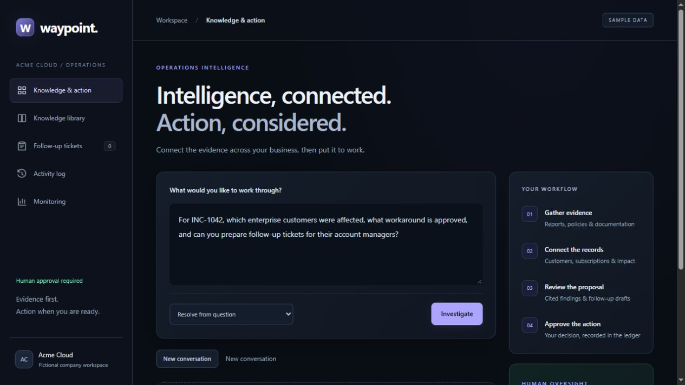
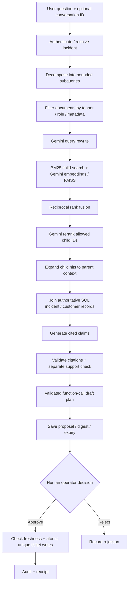

# Enterprise Knowledge & Action Copilot — Waypoint

Waypoint investigates incidents using company documents and customer records, produces cited findings, and prepares follow-up tickets that require human approval. It is a working local portfolio application for a fictional B2B software company, Acme Cloud. Gemini provides the AI inference; Python runs retrieval, permissions, orchestration and database transactions.

**Already set up? Run `.\run.cmd`, open [the application](http://127.0.0.1:8000), and connect with your operator token.** You do not need Ollama, a GPU, or a separate database installation. See [START_HERE.md](START_HERE.md) for the beginner walkthrough.



## 1. Capabilities

The capability matrix below describes implementation scope and validation coverage:

| Requirement | Implementation | Scope / evidence |
|---|---|---|
| PDF and OCR ingestion | `ingestion.py`: pdfplumber text extraction; optional Tesseract on sparse pages | Text first; OCR requires an executable installation. Extraction/OCR routing tested with mocked pages; real Tesseract not validated here. |
| Parent-child chunking | `chunking.py`, `retrieval.py` | Search 180-word children with 35-word overlap; expand selected hits to containing parents up to 600 words. Parent containment tested on long documents. |
| Metadata and permission filtering | `visible_documents`, `DocumentAccess`, API source checks | Tenant, document kind, IDs, minimum revision, document role ACLs; applied before Gemini/FAISS retrieval and authoritative incident evidence selection. |
| BM25 plus vector retrieval | `gemini_retrieval.py` | Local BM25 + Gemini embeddings + real FAISS inner-product search; reciprocal rank fusion. Mocked provider tests exercise actual FAISS. |
| Reranking | Gemini structured chunk-ID ordering | One bounded request over up to 12 candidates. Invalid/duplicate IDs cannot introduce evidence. This is LLM reranking, not a cross-encoder. |
| Query rewriting and decomposition | Gemini rewrite + `query.py` | One rewrite; deterministic bounded decomposition into impact, workaround and policy queries for incidents; simple clause splitting for knowledge questions. |
| Cited answers | `generation.py`, `workflow.py`, `gemini.py` | Source membership checks, deterministic provenance, separate Gemini claim-support verification. No proof that source records are true. |
| Formal evaluation | `evaluation.py`, fixture dataset, CLI report | Versioned JSON report, dataset/corpus hashes, retrieval metrics, workflow checks, citation coverage, pass thresholds and nonzero failure exit. Small synthetic regression set. |
| Prompt-injection tests | `security.py`, `test_requirements.py`, `test_gemini.py` | Known malicious query/document patterns, quarantine, allowlisted planning, citation checks, no automatic execution. Pattern matching is not comprehensive protection. |
| MCP tools | `mcp_server.py` | Five read/prepare tools over authenticated HTTP. No approval/execute tool. Real stdio tool-list test. |
| Action proposals | `actions.py`, `Proposal` | Durable exact payload, SHA-256 digest, evidence digest, expiry and audit record. |
| Human approval | Operator-only decision endpoint and browser button | Server validates digest, expiry, evidence freshness and pending status before writing tickets. |
| Conversation memory | `memory.py`, conversation tables, API, UI | Stores user turns; owner/tenant scoped; last five turns can resolve an incident reference such as “those customers.” Re-reads current evidence every time. |
| Docker / FastAPI | `api.py`, `Dockerfile`, `compose.yaml` | Local SQLite setup and optional PostgreSQL Compose stack. Container runtime not verified in this session. |
| Quality, latency and cost monitoring | `monitoring.py`, `OperationMetric`, Monitoring UI | Persistent verification signals, operation/stage/API latency, attempts, embedding cache counts, token usage and configurable estimated cost. Unknown cost remains null. |

## 2. What the product does

Example question:

> Which enterprise customers were affected by last week's login incident, what workaround is approved, and can you prepare follow-up tickets for their account managers?

The incident workflow resolves one incident, retrieves relevant documents, joins structured customer/subscription/impact records, distinguishes confirmed and suspected impact, identifies missing data, detects the seeded MFA policy conflict, generates cited claims, checks them, and saves eligible ticket proposals. The user reviews the exact tickets before approving them.

Tickets are real persisted records **inside this application's SQL ledger**. They are not sent to Jira, Salesforce, Zendesk, email or Slack. Integrating an external ticket provider would require a connector and a durable delivery/outbox design.

The separate **Knowledge library** answers general corpus questions without preparing actions. The incident workflow intentionally handles a narrower, controlled business process.

## 3. Run in VS Code on Windows

Prerequisites: Python 3.12 recommended (package requires 3.11+), VS Code, internet access for Gemini, and a Gemini API key with model access.

1. Open this entire project folder in VS Code.
2. Open **Terminal → New Terminal**, using PowerShell in the project root.
3. On first setup or after dependency changes:

   ```powershell
   .\setup.cmd
   ```

   This creates `.venv` if needed, installs constrained dependencies and test tools, copies `.env.example` only if `.env` does not exist, and initializes fictional data. Existing `.env` and database records are preserved.

4. Fill `GEMINI_API_KEY` in `.env`. Your existing key is preserved; do not put it into source code or the browser login.
5. Start the application:

   ```powershell
   .\run.cmd
   ```

6. Open [http://127.0.0.1:8000](http://127.0.0.1:8000). Enter `COPILOT_ADMIN_TOKEN` from `.env`. Its starter local value is `demo-admin-change-me`.
7. Select the login incident explicitly from the dropdown, then click **Investigate**. This avoids date ambiguity if the seeded incident is no longer from last week.
8. Inspect evidence, gaps and drafts. Approve when ready, then open **Follow-up tickets**, **Activity log**, and **Monitoring**.
9. Ask “Prepare follow-ups for those customers” in the same conversation. **New conversation** clears the browser's conversation pointer; it does not delete saved records.

Stop with Ctrl+C. Restart after editing `.env`. Run only one development server on port 8000.

### Which file runs?

`run.cmd` launches:

```powershell
.\.venv\Scripts\python -m uvicorn copilot.api:app --host 127.0.0.1 --port 8000
```

`copilot/api.py` defines the FastAPI application, while Uvicorn serves it and the static UI. Do not run `workflow.py` or `gemini.py` individually, and do not open `index.html` directly.

For F5, install Microsoft's Python/Python Debugger VS Code extensions, select `.venv\Scripts\python.exe`, and choose **Run Copilot (Gemini + SQLite)**. `.vscode/launch.json` supplies the module, arguments and `.env`.

### Diagnostics

```powershell
.\.venv\Scripts\python -m copilot.cli doctor
.\.venv\Scripts\python -m copilot.cli doctor --live
.\.venv\Scripts\python -m copilot.cli index
```

`doctor` checks local settings and SQL connectivity without showing the key. `--live` makes generation and embedding requests, using your quota. `index` warms the persistent embedding cache; normal retrieval populates it lazily.

## 4. Database: no manual server setup for local use

The default URL is `sqlite:///./copilot.db`. SQLAlchemy creates missing tables at startup. Seed data is inserted automatically when `COPILOT_SEED_DEMO=true`. You do not need to create a database account, tables or SQL records manually.

| Tables | Purpose |
|---|---|
| documents, document_access | Versioned document text/metadata and optional allowed-role lists |
| customers, subscriptions, orders | Business records and current subscription eligibility |
| incidents, impacts | Incident timing, authoritative document links and customer impact certainty |
| embedding_cache | Content-addressed vectors keyed by tenant, model, dimensions, task and text |
| runs, proposals | Saved analysis, proposed tickets, digests, expiry and decision state |
| tickets | Durable ticket ledger, unique per tenant + incident + customer |
| audit_events | Preparation, completion, approval/rejection and execution events |
| conversations, conversation_turns | Owned conversations and user-question/incident/run pointers |
| operation_metrics | Content-free operational measurements and verification summaries |

Data survives restarts. FAISS is rebuilt in memory from authorized cached vectors per search; it does not need a service. Embeddings persist in SQL. Changed document content gets new embedding-cache keys; old unused cache rows are not automatically cleaned up.

Missing tables are created without dropping existing records. Schema initialization uses `create_all`, not Alembic migrations. Future changes to existing columns need explicit migrations. SQLite is appropriate for this local workload; use PostgreSQL and proper migrations for larger deployments.

## 5. Retrieval and reasoning architecture



### Child search, parent context

Children contain up to 180 words with 35-word overlap (145-word stride). A child's start position maps to a parent on a 420-word stride with a maximum 600-word window. Each child is fully contained in its parent. Parents overlap; this is a deterministic two-level word-window hierarchy, not semantic/layout-aware segmentation.

The search result includes `document_id`, `chunk_id`, `revision`, `parent_id`, word offsets, `matched_excerpt`, `matched_child_ids`, and the expanded parent `excerpt`. Multiple hits for the same parent collapse into one context entry. Parent IDs include the document revision. Child IDs retain the existing document/ordinal form for compatibility; revision is a separate field.

### Hybrid retrieval and bounded decomposition

Gemini mode uses normalized `gemini-embedding-001` vectors (768 dimensions by default), local FAISS `IndexFlatIP`, and the repository's BM25 implementation. A rewritten query plus up to three subqueries produces at most four retrieval queries. Document/query embeddings are batched and cached. BM25 and dense ranked lists are combined with reciprocal rank fusion using a constant of 60. Up to 12 fused child candidates go to one Gemini reranking request before parent expansion.

Incident decomposition covers customer impact, approved workaround and operating policy. General knowledge decomposition uses bounded clause splitting. This is intentionally deterministic decomposition, not an open-ended planning agent. A normal eligible incident run has roughly five generation calls: rewrite, rerank, answer, verify and proposal planning. Empty evidence or blocked drafts may reduce that count. Transient errors have at most two retries per provider request.

### Evidence, authority and verification

The incident path uses linked authoritative documents and deterministic SQL eligibility, rather than allowing top search hits to redefine business policy. Imported documents become searchable; they do not automatically replace approved procedures or impact links.

Generated claims require source IDs. The verifier checks source membership and performs a separate Gemini support judgement. A malformed/partial verdict, unknown citation or rejected incident claim prevents an actionable proposal. The offline mode uses exact extractive quotes/templates and is labelled explicitly. No failed Gemini request silently falls back to offline output.

The model's function call can propose only `prepare_followups` with the exact resolved incident and eligible customer IDs. It cannot provide arbitrary executable code, choose arbitrary SQL, approve actions or change policy-controlled ticket bodies. Returned function arguments are validated before saving a proposal.

Streaming sends progress first. Final claims and proposals are sent only after verification and persistence, not token-streamed before checking.

## 6. Permissions and prompt injection

Both roles authenticate with bearer tokens. `operator` can approve/reject and read monitoring/audit data; `analyst` can search, answer and prepare proposals. These are shared development identities, not individual SSO users.

Documents without explicit ACLs are readable by both roles only when visibility is `internal`. An explicit `DocumentAccess` row replaces that default with an allowed-role list. An empty list denies both roles. Tenant constraints always apply. Document filtering occurs before embeddings, reranking and generation. Source endpoints, saved-run evidence reads, ticket lists and approval freshness also recheck relevant document access.

Manage document access locally:

```powershell
# Only operators can read this document:
.\.venv\Scripts\python -m copilot.cli access acme:KB-208 --roles operator
# Restore access to both roles:
.\.venv\Scripts\python -m copilot.cli access acme:KB-208 --roles operator analyst
# Deny both roles:
.\.venv\Scripts\python -m copilot.cli access acme:KB-208 --roles
```

Structured customer/incident records remain tenant scoped; document ACLs are not customer-level entitlements. Conversation and saved-run access also require the creating actor. An operator does not automatically gain access to another actor's private saved analysis.

`security.py` detects a small explicit set of malicious instruction patterns (instruction override, secret disclosure, approval bypass, system/tool markers). Matching documents are quarantined from retrieval/source access; matching user requests are rejected. This heuristic can both miss attacks and flag legitimate security documentation. It complements untrusted-evidence prompts, strict schemas, source checks, function allowlists and the server-controlled approval boundary. It is not a claim of complete injection detection.

## 7. Human approval, reliability and duplicate prevention

1. Save the exact proposed ticket payload, SHA-256 payload digest, evidence snapshot digest and expiry (default 60 minutes).
2. Require the operator's explicit approve/reject request with the reviewed digest.
3. Check role, digest integrity, pending state, expiry and current evidence snapshot.
4. Use a compare-and-swap status update to serialize competing decisions.
5. Write tickets and audit events in one SQL transaction.
6. Enforce a database uniqueness constraint on `(tenant, incident_id, customer_id)`.
7. Repeated approval returns the existing receipt. A new proposal for the same customer/incident reuses an existing ticket. Stale evidence requires a new analysis.

The atomicity guarantee covers the local SQL action ledger. No distributed exactly-once delivery to external services is claimed. Historical subscription eligibility is not reconstructed: current subscription status is used.

## 8. Conversation memory

Requests to `/api/runs`, `/api/runs/stream` and `/api/answers` accept an optional `conversation_id`; successful responses return one. Omit it to start a conversation. `GET /api/conversations/{id}` returns up to 100 stored user turns to the owning actor in the same tenant.

The memory resolver considers the five most recent user turns and may reuse their incident ID when a follow-up refers to “it,” “that,” “same,” “these,” “them,” or “those.” Explicit incident IDs and “last week” take precedence. Every run still queries current evidence and permissions. Prior model answers are never injected as authoritative evidence.

The incident UI retains the conversation ID in tab memory. Refreshing starts a new browser conversation; API clients can resume an owned conversation using its saved ID. The Knowledge library UI currently starts independent answers; its API supports passing an incident context via conversation ID. Memory is bounded incident-reference resolution, not unrestricted multi-topic dialogue or a vector memory store. User turns remain stored in SQL until you implement a retention/deletion policy.

## 9. Monitoring quality, latency and cost

Open **Monitoring** as the operator, or call `GET /api/metrics`. The endpoint summarizes the latest 200 operations in your tenant:

- Operation count, error rate, p50 and p95 latency (nearest-rank percentiles).
- Per-operation elapsed time and workflow-stage elapsed times.
- Provider attempt HTTP/network status and timing, successful provider-call usage, retry count.
- Embedding cache hit/miss counts when Gemini retrieval runs.
- Accepted/rejected claim counts and verification outcome, when available.
- Estimated USD when the required token usage and prices are known.

Monitoring covers API knowledge answers and incident runs, including SSE. It is not a full distributed tracing/alerting platform and does not instrument standalone CLI indexing or approval transactions. Quality counters are support-check signals, not benchmark accuracy.

Configure your actual provider prices in `.env` using USD per million tokens:

```ini
# Supply numbers from your own model/account pricing; no defaults are assumed.
# COPILOT_INPUT_USD_PER_MILLION=
# COPILOT_OUTPUT_USD_PER_MILLION=
# COPILOT_EMBEDDING_USD_PER_MILLION=
```

Generation estimates include reported output and thought tokens. Missing rates, missing token usage, retries with uncertain billing, or failed operations produce **null / Unknown**, not a fabricated zero. An entirely offline successful operation with no provider calls has estimated cost zero. The embedding endpoint may omit token usage, making the overall estimate unknown even when generation usage is present. Cached embeddings avoid repeated embedding charges. Estimates are not provider invoices and do not establish free-tier eligibility.

Telemetry contains no prompt bodies, document text, API keys or bearer tokens. Ordinary run/conversation tables do contain business content. Metric persistence is best effort and cannot undo a completed action transaction. There is no metric retention job yet.

## 10. Ingest documents and scanned PDFs

```powershell
.\.venv\Scripts\python -m copilot.cli ingest .\handbook.md --kind policy --title "Operating handbook"
.\.venv\Scripts\python -m copilot.cli ingest .\report.pdf --kind incident
.\.venv\Scripts\python -m copilot.cli index
```

Supported file types: UTF-8 `.txt`, `.md`, and `.pdf`. Kinds: `product`, `support`, `incident`, `policy`. Re-ingesting the same absolute path updates that document; changed content, title or kind increments its revision. Moving a file changes the path-derived document ID. Text retains page markers, but precise bounding-box/page citation metadata is not implemented.

PDF extraction tries embedded text first. Pages with fewer than 30 non-whitespace characters require `--ocr` or manual inspection. Empty OCR output is rejected. OCR is optional:

```powershell
.\.venv\Scripts\python -m pip install -e ".[pdf]"
tesseract --version
.\.venv\Scripts\python -m copilot.cli ingest .\scanned-report.pdf --kind incident --ocr
```

Install the Tesseract executable separately and make it available on PATH before the second command. Installing `pytesseract` alone does not install the OCR engine. Language selection/layout/table reconstruction and OCR accuracy evaluation are outside this implementation. No OCR model download is needed for normal embedded-text PDFs.

## 11. Tests and reproducible evaluation

```powershell
.\.venv\Scripts\python -m pytest -q
.\.venv\Scripts\python -m ruff check copilot tests
node --check copilot/static/app.js
.\.venv\Scripts\python -m copilot.cli evaluate --offline --output reports/evaluation.json
```

Tests mock Gemini so they do not spend your API quota. They exercise real SQLite transactions, real local FAISS search and the MCP stdio tool catalogue. Tests cover provider response validation, source checking, planning restrictions, tenant/role filtering, parent containment, memory ownership/freshness, prompt injection, OCR routing, monitoring, concurrent/repeated approval, expiry, stale evidence and streaming order.

The formal regression evaluation has **4 workflow cases and 7 retrieval cases**. Workflow pass checks exact expected affected customers, draft counts and a required source. Citation coverage records how many returned claims resolve to supplied sources. Retrieval uses one labelled relevant document per query at `k=3` and reports hit/recall@3, precision@3, MRR@3 and nDCG@3. Precision uses a fixed denominator of three even when fewer hits return. Recall@3 equals hit rate for these single-relevant-document labels.

Passing requires 100% workflow accuracy and 100% retrieval hit rate@3 on this fixture set. Reports include UTC time, schema version, configuration, dataset/corpus hashes, per-case results and evaluation elapsed time; failure exits with code 1. The dataset lives in `copilot/data/evaluation.json` and retrieval labels in `evaluation.py`.

Latest offline baseline: **48 tests passing**, workflow accuracy **1.0**, hit rate@3 **1.0**, MRR@3 **0.905**, nDCG@3 **0.929**. See [reports/evaluation.json](reports/evaluation.json) and [verification notes](docs/verification.md).

These are development regression results on fictional seed data, not a held-out production benchmark. Labels have not been independently reviewed. Before making accuracy claims, add independently labelled questions, separate development/test sets, multiple relevant documents, human answer-quality ratings, adversarial cases and live Gemini evaluation. Removing `--offline` runs the configured pipeline and consumes API quota; it does not turn synthetic labels into production evidence.

## 12. API contract

All `/api/*` endpoints require `Authorization: Bearer <local-role-token>`. Health and static pages are public. Interactive API documentation: [Swagger](http://127.0.0.1:8000/docs); machine schema: `/openapi.json`.

| Method / route | Purpose |
|---|---|
| GET `/health` | Database connectivity and retrieval backend |
| GET `/api/me` | Safe role/model configuration, never keys |
| GET `/api/incidents` | Tenant's incidents |
| GET `/api/search` | `q`, repeated `kinds`, repeated `document_ids`, `min_revision` filters |
| POST `/api/answers` | Cited knowledge response, optional conversation ID |
| GET `/api/sources/{id}` | Authorized current document text |
| POST `/api/runs` | Analyze incident and save reviewable proposal |
| POST `/api/runs/stream` | Same workflow, SSE `progress`, `result`, `error` events |
| GET `/api/runs/{id}` | Owned saved result with current source-access checks |
| POST `/api/proposals/{id}/decision` | Operator approve/reject exact digest |
| GET `/api/tickets` | Tenant tickets whose linked evidence is currently readable |
| GET `/api/audit` | Latest 200 tenant audit records, operator only |
| GET `/api/conversations/{id}` | Owned user-turn history |
| GET `/api/metrics` | Latest 200 tenant operation measurements, operator only |

Example bodies:

```json
{"question":"Analyze INC-1042","incident_id":"acme:INC-1042"}
```

```json
{"question":"Prepare follow-ups for those customers","conversation_id":"<returned ID>"}
```

```json
{"decision":"approve","digest":"<exact 64-character digest returned with proposal>"}
```

Example filtered search: `/api/search?q=SAML&kinds=product&document_ids=acme:KB-208&min_revision=1`.

Typical failures: 401 missing/invalid token, 403 insufficient role/access, 404 unavailable owned resource, 409 changed/expired/concurrent proposal, 422 request validation, 400 detected malicious query, 503 provider/retrieval failure. Once SSE starts, errors are delivered as `error` events instead of changing the HTTP status.

## 13. MCP integration

`copilot/mcp_server.py` exposes:

- `search_knowledge(query)`
- `answer_knowledge(question)`
- `list_incidents()`
- `prepare_followups(question, incident_id?)`
- `get_analysis(run_id)`

Start the API first. Configure your MCP client using [mcp.example.json](mcp.example.json), replacing its executable path with this workspace's `.venv\Scripts\copilot-mcp.exe`. Pass `COPILOT_API_URL=http://127.0.0.1:8000` and `COPILOT_MCP_TOKEN` set to the **analyst token**, not the Gemini key. The stdio gateway does not read `.env` itself. It forwards calls to the authenticated API; the API owns permissions and state. The tool surface has no approval/execute operation.

## 14. Configuration reference

| Environment setting | Default / use |
|---|---|
| `GEMINI_API_KEY` | Empty until supplied; server-side SecretStr/header only |
| `GEMINI_GENERATION_MODEL` | Current workspace default `gemini-3.8-flash`; configurable |
| `GEMINI_EMBEDDING_MODEL` | `gemini-embedding-001` |
| `COPILOT_DATABASE_URL` | `sqlite:///./copilot.db` |
| `COPILOT_SEED_DEMO` | `true`: initialize fictional data if absent |
| `COPILOT_TENANT` | `acme` |
| `COPILOT_ADMIN_TOKEN` / `COPILOT_READER_TOKEN` | Distinct development role tokens; replace for exposure beyond local use |
| `COPILOT_RETRIEVAL_BACKEND` | `gemini`; `local` is BM25-only offline mode; `opensearch` is optional legacy route |
| `COPILOT_GENERATION_BACKEND` | `gemini`; `extractive` is explicit offline mode |
| `COPILOT_GEMINI_DIMENSIONS` | 768, configurable within validated range |
| `COPILOT_GEMINI_REWRITE` / `COPILOT_GEMINI_RERANK` | `true` |
| `COPILOT_PROPOSAL_TTL_MINUTES` | 60, valid range 1–1440 |
| `COPILOT_INPUT_USD_PER_MILLION` / `COPILOT_OUTPUT_USD_PER_MILLION` / `COPILOT_EMBEDDING_USD_PER_MILLION` | Optional nonnegative rates; omit when unknown |
| `COPILOT_API_URL` / `COPILOT_MCP_TOKEN` | MCP client process environment |

Model names are configurable, and account access/quota must be checked. No free-tier or future availability guarantee is made. The earlier live attempt found 2.5 Flash unavailable for this account, and generation with the configured replacement returned temporary HTTP 503; embedding succeeded. That is historical validation, not a current provider-status check. The latest live check on 7 November 2026 could not reach Gemini. A complete successful live generation workflow is still unverified; run `doctor --live` before recording.

Optional legacy settings (`COPILOT_OPENSEARCH_URL`, `COPILOT_OPENSEARCH_INDEX`, `COPILOT_EMBEDDING_MODEL`, `COPILOT_RERANKER_MODEL`, `COPILOT_RERANK`) are only for the separate local-transformer/OpenSearch route. It is not required, and installing `.[retrieval]` downloads local model dependencies. The Gemini default does not use Ollama or downloaded language-model weights.

## 15. Docker deployment

```powershell
docker compose config --quiet
docker compose up --build -d
docker compose logs -f api
```

Compose creates PostgreSQL and a persistent named volume, waits for database health, then starts the API bound to the host's loopback port 8000. It reads Gemini/model and role-token settings through environment substitution; `.env` is excluded from the image. Local SQLite records are not automatically migrated to PostgreSQL. Stop with `docker compose down`; do not add volume deletion flags if you want to preserve records.

Optional OCR image build:

```powershell
docker build --build-arg INSTALL_OCR=true -t waypoint-ocr .
```

This installs Tesseract and the Python OCR extra in the image. The default image omits OCR. Docker runtime/PostgreSQL integration and this OCR build have not been exercised here. Use one API process during initial schema creation; production requires managed migrations, individual auth, TLS, rate limiting, backup/restore, durable jobs and retention policies.

## 16. Repository map

```text
copilot/
  api.py                 FastAPI routes, auth wiring, SSE and static serving
  auth.py                Shared local operator/analyst identity
  config.py              Validated environment configuration
  db.py / models.py      SQLAlchemy engine and database schema
  seed.py / data/        Fictional company corpus and regression fixtures
  ingestion.py           Text/PDF extraction and optional OCR
  chunking.py             Parent context and child-to-parent mapping
  retrieval.py            BM25, filtering, parent expansion, optional OpenSearch
  gemini_retrieval.py      Cached embeddings, FAISS, fusion and reranking
  gemini.py               Gemini REST, typed output, claim checks, tool planning
  query.py                Bounded query decomposition
  security.py             Known injection-pattern guards/quarantine
  generation.py           General knowledge answer and extractive mode
  workflow.py             LangGraph incident workflow and evidence snapshot
  actions.py              Proposals, decisions, ticket transaction and audit
  memory.py               Owned conversation context and user turns
  monitoring.py           Operation timing, provider usage and estimated cost
  evaluation.py           Regression metrics and reproducible report
  cli.py                  seed / index / ingest / access / doctor / evaluate
  mcp_server.py           Read/prepare-only MCP stdio gateway
  static/                 Browser HTML, CSS and JavaScript
 tests/                   Automated regression/security/contract tests
 reports/evaluation.json  Latest offline evaluation artifact
 docs/                    Architecture, API, recording and verification notes
 .vscode/                 Debug configuration
 .env.example             Nonsecret configuration template
 requirements.lock        Installed core/test dependency constraints
 Dockerfile / compose.yaml Container + PostgreSQL deployment
 setup.cmd / run.cmd      Windows setup and launch
```

## 17. Recording and honest presentation

“Demo” in seed flags or starter tokens describes fictional sample data and development credentials. It does not mean the running Gemini application uses mocked responses. **Tests** mock the API; the default application makes real Gemini requests. The **Sample data** label stays visible so viewers understand the dataset.

Use [the recording guide](docs/recording-guide.md): show the question, cited answer, conflicts/gaps, exact proposed tickets, human approval, duplicate-safe ticket ledger, activity log, a context-follow-up question, and Monitoring. Show the offline evaluation report with its mode and synthetic-data limitation. Keep keys and `.env` out of the video.

This project does not implement GraphRAG, trained Self-RAG, arbitrary autonomous tool execution, general contradiction proof, individual SSO, historical subscription reconstruction, external ticket delivery, production-scale retrieval or a held-out accuracy benchmark. Those are separate extensions. Gemini mode sends authorized selected document content and questions to Google's API.
