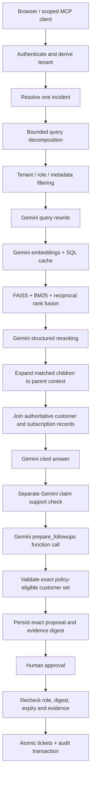

# Architecture

The default stack is Gemini API + FastAPI + LangGraph + SQLite + local FAISS/BM25. No AI model weights are downloaded.

## Deterministic boundaries

The credential determines role and tenant. The model cannot select another tenant, invent authorized recipients, bypass approval, execute arbitrary SQL, or invoke arbitrary function names. Curated incident-to-policy/workaround relationships and impact records decide eligibility. The only planning function is `prepare_followups`; returned incident/customer IDs must exactly match the server's allowed set. Draft text and assignments are assembled from those validated records. The model-generated answer is displayed alongside the deterministic findings.

The generation and verification calls are separate. All claims must cite known source IDs. Missing, duplicate or incomplete verifier verdicts fail closed. If any incident-answer claim is rejected, no executable proposal is saved. A second model is still fallible: support checking is not a guarantee of truth. The seeded MFA contradiction also has a deterministic rule; arbitrary contradiction discovery is not complete.

## Retrieval and persistence

Gemini creates normalized document/query embeddings. SQLite caches vectors by tenant, model, dimensions, task type and content hash. FAISS is rebuilt in memory from currently authorized documents for each query; obsolete cached content is never selected merely because it remains in the cache. BM25 and semantic ranks are combined using reciprocal rank fusion, then a Gemini call orders candidates. Reranker output is constrained to known IDs; duplicates and foreign IDs cannot enter results.

Ingestion uses pdfplumber's embedded text extraction first, and optional Tesseract only on sparse/scanned pages. Imported text is untrusted evidence, not authorization policy. Chunk references retain document IDs, revision and PDF page markers.

SQLite stores all application records and vectors in `copilot.db`. SQLAlchemy initializes tables; seed data is inserted once. PostgreSQL can replace SQLite via a configured URL or Compose. Existing schemas need proper migrations before production evolution; `create_all` only creates absent tables.

## Approval and duplicate prevention

Analysis persists a run and an exact proposal but creates no tickets. Each proposal has a payload digest, evidence snapshot digest, expiry and status. The operator submits the exact digest. Evidence changes require a new analysis. A compare-and-swap changes `pending` into `executed` or `rejected`; ticket inserts and audit events commit together. A uniqueness constraint on tenant/incident/customer prevents duplicates across separate proposals and concurrent requests. An executed approval retry returns its receipt; later proposals reuse existing tickets rather than editing them silently.

Direct concurrent database administration is trusted and can race the freshness check. Production data mutations must share incident locking/versioning or serializable transaction protocols with approval. The current app has no source-record editing HTTP API.

## Operational boundaries

The Gemini API key is loaded server-side from the ignored `.env`. It is sent to Google in a header, never to the browser. Documents/questions in Gemini mode go to Google. API errors are sanitized; network, quota, model availability and malformed output failures surface without pretending to complete an analysis. Transient 429/5xx responses receive at most two retries.

MCP uses the analyst access token and exposes read/prepare tools only. An operator bearer token is a shared local-development capability, not individual SSO identity. The audit ledger is application-append-only, not tamper-proof against a database administrator.

Tickets are local application records. A real Jira/Linear/CRM integration would require a transactional outbox, stable remote idempotency keys, retry/reconciliation and delivery status. In-flight analysis is not checkpointed; interrupted analyses can be rerun. External exactly-once delivery is not claimed.

## Conversation and monitoring additions

Conversation/turn tables bind history to tenant and actor. The last five questions supply only a recent incident pointer for referring follow-ups; no historical model answer becomes authoritative evidence. Current records and ACLs are re-read. Browser New conversation clears its pointer without deleting durable records.

Operation metrics persist elapsed time, per-stage timing, provider-attempt status, usage, verification signals and embedding-cache counts. Provider prices are optional and account-specific; incomplete usage/pricing/retry billing yields null cost. The operator-only Monitoring view summarizes the latest 200 operations. Metrics contain no prompts, source text or credentials. Telemetry is best effort and is not a distributed tracing backend.

Document access rules override default internal visibility with explicit allowed roles. SQL record access remains tenant scoped. Known injection patterns are quarantined before retrieval and authoritative incident source selection; the heuristic is imperfect and supplements schema/tool/approval boundaries.
